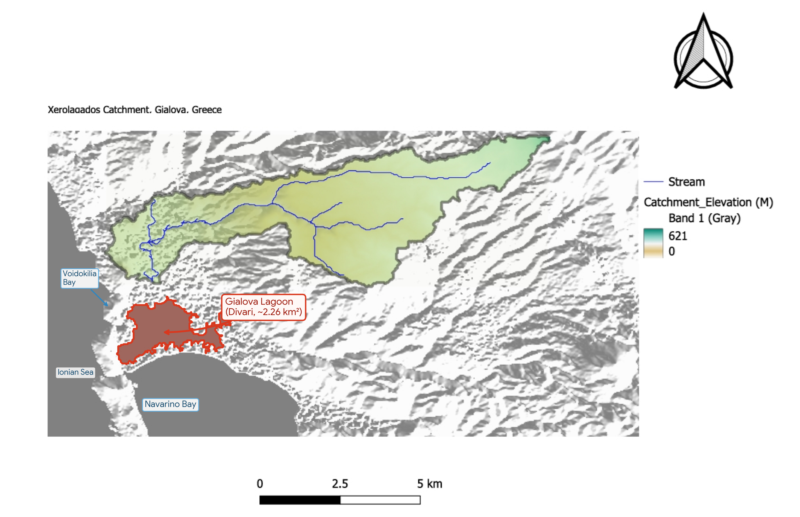

# Gialova Lagoon: Hydrological & Salinity Modeling

## 📌 Project Overview
The Gialova Lagoon in southern Greece is a Natura 2000 protected wetland facing ecological collapse due to upstream water diversion and climate change. This project uses a multi-tool approach (QGIS, Python, and STELLA) to evaluate the impact of three river restoration scenarios on the lagoon's water volume and salinity between 2001 and 2050.

## 🛠️ Methodology & Tools
*   **Spatial Analysis (QGIS):** Delineated the 22 km² Xerolagados catchment, calculated mean slope (5.88°), and extracted the stream network.
*   **Data Processing (Python):** Fetched historical climate data via Open-Meteo API. Applied the Turc equation to calculate Potential Evapotranspiration (PET) and projected climate scenarios to 2050.
*   **System Dynamics (STELLA):** Built a mass-balance model simulating lagoon volume, seawater exchange, and salt dynamics.
*   **Field Validation:** Model parameters were calibrated using real-world 2025 field measurements (EC, water depth, and dissolved oxygen). 

## 📊 Visualizations

### 1. QGIS Catchment Delineation

*Delineation of the 22 km² Xerolagados catchment feeding into the lagoon.*

### 2. Python Scenario Dashboard

*Panel A shows salinity trajectories. Panel B shows water depth stability. Panel C shows the climate water balance (PET vs. Precipitation). Panel D shows the net sea exchange.*

### 3. STELLA System Dynamics Model

*The STELLA model linking catchment runoff, precipitation, evaporation, and sea exchange.*

## 💡 Key Findings

1.  **Baseline (Disconnected River):** With the river cut off by agriculture, the lagoon relies solely on groundwater and direct rainfall. Salinity spikes to >60 PSU, turning the lagoon hypersaline.
2.  **Full Restoration (100% River Flow):** Reconnecting the full historical flow floods the lagoon (depth > 1.0m) and drops salinity to ~15 PSU, destroying the delicate brackish ecosystem.
3.  **Partial Managed Restoration (50% Flow):** The optimal scenario. The water depth stabilizes between 0.6m and 0.77m, and salinity oscillates naturally between 20 and 50 PSU. **This matches my 2025 field validation measurement of 40.1 PSU.**

## 🏆 Conclusion
Complete disconnection is fatal, and full reconnection is destructive. The only scientifically viable solution is a **50% managed partial restoration**, requiring a flow-control structure (weir/sluice) to mimic historical brackish conditions and protect the Natura 2000 habitat.
