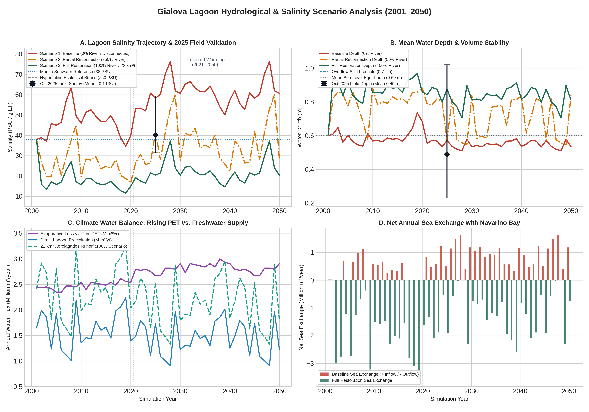
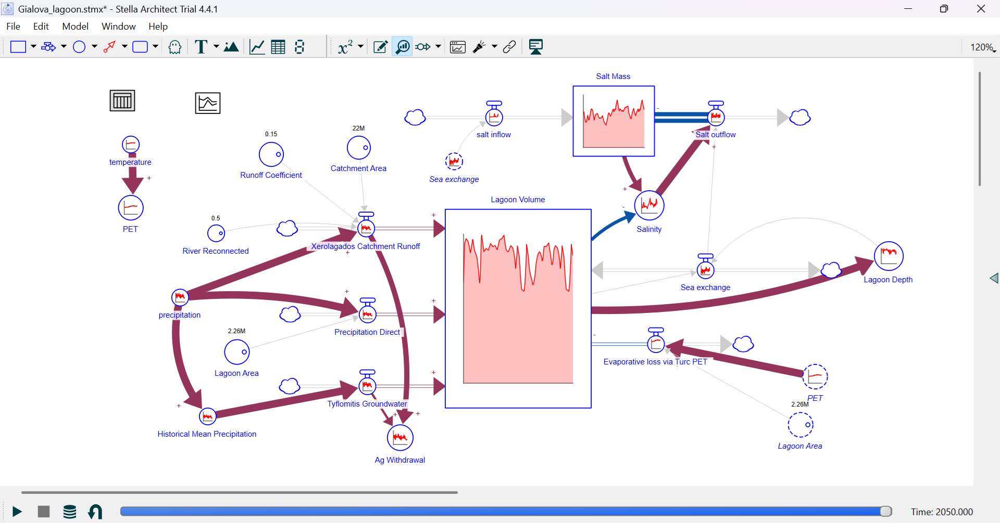

# Gialova Lagoon: Hydrological & Salinity Modeling

## 📌 Project Overview
Mediterranean coastal lagoons face compounding ecological threats from historical hydromorphological alterations and accelerating climate warming. Gialova Lagoon (Divari), a Natura 2000 coastal wetland in southwestern Peloponnese, Greece, has experienced chronic late-summer hypersalinity since the 1960 construction of a flood-diversion embankment that routed the Xerolagados River westward into Voidokilia Bay. This study integrates spatial terrain analysis in QGIS, empirical hydrochemical benchmarking from an October 2025 field campaign, and a 50-year coupled water-and-salt System Dynamics model in STELLA Architect (2001–2050) to evaluate hydrological restoration strategies under projected warming (+1.79 °C) and precipitation decline (−11.4%). Topographic watershed delineation on a 30 m Digital Elevation Model (DEM) isolated a
22 km2 effective surface sub-catchment for the Xerolagados stream, distinct from the eastern Tyflomitis karst/alluvial aquifer system. Model validation against October 2025 field observations (mean main-basin salinity of 40.1 PSU, range 31.4–59.4 PSU; mean depth 0.49 m) confirmed that maintaining the disconnected baseline (Scenario 1, 0% river inflow) drives projected 2021–2050 mean salinity to 60.98 PSU (peaking at 76.30 PSU), exceeding the 50 PSU ecological stress threshold for benthic fauna and fish. Conversely, full river reconnection (Scenario 3, 100% inflow) lowers projected mean salinity to 22.12 PSU but pushes water levels above the 0.77 m overflow sill threshold in 47 of 50 simulated years (94%), creating persistent inundation risks for surrounding agricultural lands. A 50% partial diversion strategy (Scenario 2) emerges as an optimal management compromise (“Goldilocks” solution), buffering projected mean salinity at 35.55 PSU while reducing overbank flood frequency and accommodating agricultural water demands.

## 🛠️ Methodology & Tools
*   **Spatial Analysis (QGIS):** Delineated the 22 km² Xerolagados catchment, calculated mean slope (5.88°), and extracted the stream network.
*   **Data Processing (Python):** Fetched historical climate data via Open-Meteo API. Applied the Turc equation to calculate Potential Evapotranspiration (PET) and projected climate scenarios to 2050.
*   **System Dynamics (STELLA):** Built a mass-balance model simulating lagoon volume, seawater exchange, and salt dynamics.
*   **Field Validation:** Model parameters were calibrated using real-world 2025 field measurements (EC, water depth, and dissolved oxygen). 

## 📊 Visualizations

### 1. QGIS Catchment Delineation

*Delineation of the 22 km² Xerolagados catchment feeding into the lagoon.*

### 2. Python Scenario Dashboard

*Panel A shows salinity trajectories. Panel B shows water depth stability. Panel C shows the climate water balance (PET vs. Precipitation). Panel D shows the net sea exchange.*

### 3. STELLA System Dynamics Model

*The STELLA model linking catchment runoff, precipitation, evaporation, and sea exchange.*

## 💡 Key Findings

1.  **Baseline (Disconnected River):** With the river cut off by agriculture, the lagoon relies solely on groundwater and direct rainfall. Salinity spikes to >60 PSU, turning the lagoon hypersaline.
2.  **Full Restoration (100% River Flow):** Reconnecting the full historical flow floods the lagoon (depth > 1.0m) and drops salinity to ~15 PSU, destroying the delicate brackish ecosystem.
3.  **Partial Managed Restoration (50% Flow):** The optimal scenario. The water depth stabilizes between 0.6m and 0.77m, and salinity oscillates naturally between 20 and 50 PSU. **This matches my 2025 field validation measurement of 40.1 PSU.**

## 🏆 Conclusion
Complete disconnection is fatal, and full reconnection is destructive. The only scientifically viable solution is a **50% managed partial restoration**, requiring a flow-control structure (weir/sluice) to mimic historical brackish conditions and protect the Natura 2000 habitat.
